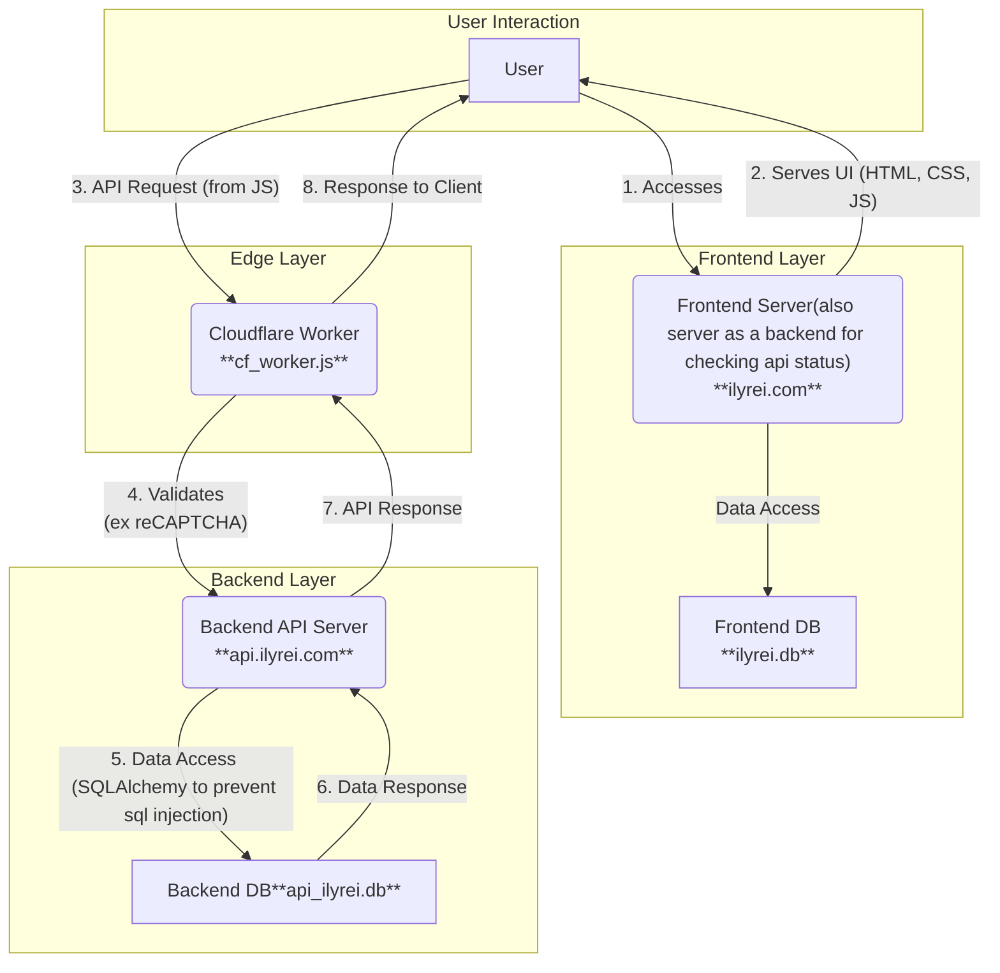

### **다이어그램 설명:**

1.  **User (사용자)**: 최종 사용자입니다.
2.  **Frontend Server (ilyrei.com / ilyrei.py)**: Flask 앱으로, 사용자에게 웹 페이지(HTML, CSS, JS)를 제공합니다. `ilyrei.db`는 프론트엔드 관련 데이터(예: 세션)를 저장할 수 있습니다.
3.  **Cloudflare Worker (cloudflare_worker.js)**: 엣지 계층에서 사용자 요청을 가로채고, reCAPTCHA 검증 등 전처리 후 백엔드 API로 프록시합니다.
4.  **Backend API Server (api.ilyrei.com / app.py)**: Flask 앱으로, 핵심 비즈니스 로직을 처리하고 `app.db` 데이터베이스와 상호작용합니다.
5.  **Backend DB (app.db)**: 백엔드 API의 주요 데이터를 저장하는 데이터베이스입니다.

**흐름:**
*   사용자는 프론트엔드 서버에 접속하여 UI를 받습니다.
*   UI의 JavaScript는 API 요청을 Cloudflare Worker로 보냅니다.
*   Worker는 요청을 검증하고 백엔드 API로 전달합니다.
*   백엔드 API는 DB와 통신하여 데이터를 처리하고 Worker에게 응답합니다.
*   Worker는 이 응답을 사용자에게 전달하여 UI를 업데이트합니다.

```
