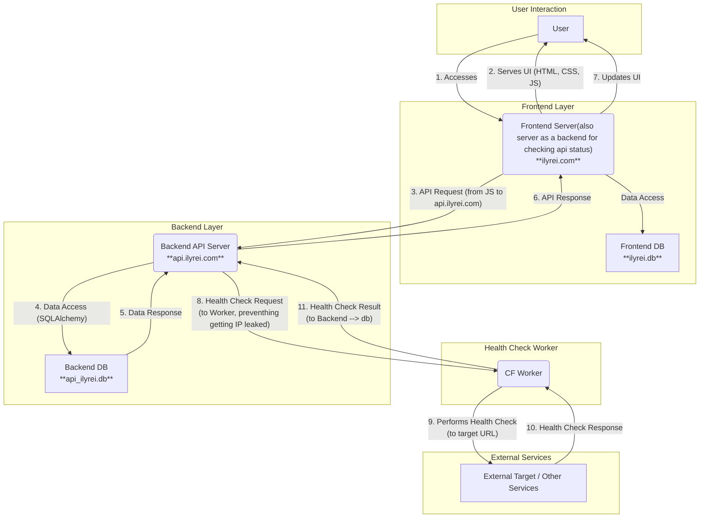

### **다이어그램 설명:**

1.  **User (사용자)**: 최종 사용자입니다.
2.  **Frontend Server (ilyrei.com / ilyrei.py)**: Flask 앱으로, 사용자에게 웹 페이지(HTML, CSS, JS)를 제공합니다. `ilyrei.db`는 프론트엔드 관련 데이터(예: 세션)를 저장할 수 있습니다.
3.  **Health Check Worker (quiet-bird-127f.jioh.workers.dev)**: 독립적으로 배포된 Cloudflare Worker로, 백엔드 API 서버의 요청을 받아 외부 서비스 헬스 체크를 대리 수행합니다.
4.  **Backend API Server (api.ilyrei.com / app.py)**: Flask 앱으로, 핵심 비즈니스 로직을 처리하고 `app.db` 데이터베이스와 상호작용합니다. **외부 서비스 헬스 체크 시 Health Check Worker에게 요청을 보냅니다.**
5.  **Backend DB (app.db)**: 백엔드 API의 주요 데이터를 저장하는 데이터베이스입니다.
6.  **External Target / Other Services**: Health Check Worker가 헬스 체크하는 대상 외부 서비스들입니다.

**주요 흐름:**
*   **1-2. UI 서빙**: 사용자는 프론트엔드 서버에 접속하여 UI를 받습니다.
*   **3-7. 일반 API 요청**: 프론트엔드 JavaScript는 `api.ilyrei.com` 백엔드 API 서버로 직접 요청을 보내고 응답을 받아 UI를 업데이트합니다.
*   **8-11. 헬스 체크 요청**: 백엔드 API 서버는 외부 서비스 헬스 체크를 위해 Health Check Worker에게 요청을 보내고, Worker는 외부 서비스를 체크한 후 결과를 백엔드에 반환합니다.
```
